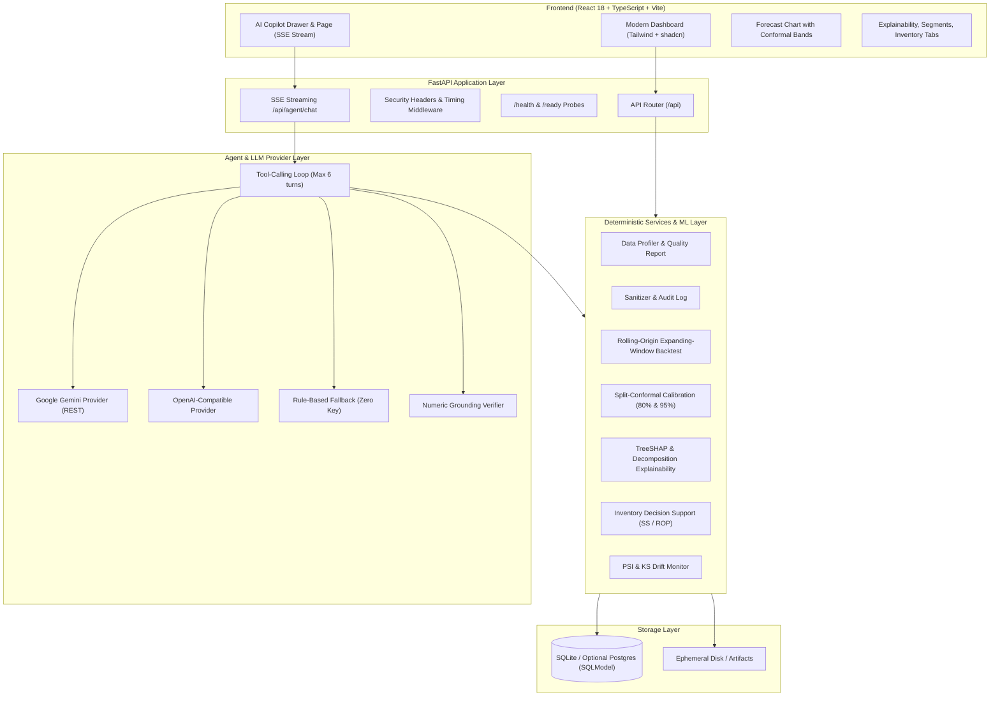

# Forecastly 📈

[](https://github.com/Swaroop677/sales-forecasting/actions)
[](LICENSE)
[](https://www.python.org/)
[](https://react.dev/)
[]()

> **Automated Sales Forecasting, Conversational AI Intelligence, and Inventory Optimization.**  
> Transforms historical transactions into calibrated multi-step forecasts with model leaderboard comparison, TreeSHAP explainability, and split-conformal uncertainty intervals in 3 clicks.

---

## 🌟 Key Highlights

- **Multi-Model Rolling-Origin Backtesting**: Automatically evaluates Seasonal Naive, Holt-Winters, LightGBM, and XGBoost across expanding test folds with zero data leakage. Selects the champion model by out-of-sample WAPE.
- **Split-Conformal Prediction Intervals**: Model-agnostic 80% and 95% uncertainty bands calibrated from backtest residuals with empirical coverage tracking.
- **Conversational AI Forecasting Copilot (⌘K)**: Streamed SSE agent powered by Google Gemini, OpenAI-compatible APIs (Groq/Ollama/OpenRouter), or a zero-key Rule-Based Fallback. All numbers are strictly verified against deterministic pipeline results.
- **TreeSHAP & Decomposition Explainability**: Global driver importance and local "Why this number?" waterfall breakdowns.
- **Inventory Decision Support**: Safety stocks ($SS = z \cdot \sigma_e \cdot \sqrt{L}$), reorder point (ROP), and suggested replenishment sizes with status chips and CSV export.
- **Data Drift Monitoring**: Population Stability Index (PSI) and Kolmogorov-Smirnov (KS) test for feature staleness alerts.
- **Multi-Sheet Excel & Printable PDF Reports**: One-click professional multi-sheet Excel exports and `@media print` formatted executive reports.
- **Free-Host Constraints**: Strictly adheres to $\le$ 2 GB RAM, CPU-only instances with background in-process jobs.

---

## 📸 Screenshots

| Overview & KPI Dashboard | Forecast Studio & Conformal Bands |
|:---:|:---:|
| *(Screenshot Placeholder: Overview)* | *(Screenshot Placeholder: Forecast Studio)* |

| AI Copilot Drawer (⌘K) | TreeSHAP Driver Explainability |
|:---:|:---:|
| *(Screenshot Placeholder: AI Copilot)* | *(Screenshot Placeholder: Explainability)* |

---

## 🏗️ System Architecture



---

## ⚡ Quick Start

### 1. Local Development

```bash
# 1. Clone repository
git clone https://github.com/Swaroop677/sales-forecasting.git
cd sales-forecasting

# 2. Setup Python environment
python3 -m venv .venv
source .venv/bin/activate
pip install -r backend/requirements.txt

# 3. Start Backend
uvicorn backend.app.main:app --host 0.0.0.0 --port 8080 --reload

# 4. In a second terminal, start Frontend
cd frontend
npm install
npm run dev
```
Open **[http://localhost:5173](http://localhost:5173)** in your browser.

---

### 2. Single-Container Production Run

```bash
docker build -t forecastly .
docker run -p 8080:8080 forecastly
```
Visit **[http://localhost:8080](http://localhost:8080)**.

---

## 🛠️ Tech Stack

| Layer | Technologies |
|---|---|
| **Backend** | Python 3.11, FastAPI, SQLModel (SQLite / PostgreSQL), Pydantic v2 |
| **Forecasting & ML** | LightGBM, XGBoost, Statsmodels, Scikit-learn, OpenMP |
| **Explainability** | TreeSHAP (native contributions), Classical Decomposition |
| **Frontend** | React 18, TypeScript (strict), Vite, Tailwind CSS, shadcn/ui, Recharts |
| **AI Copilot** | Google GenAI REST, OpenAI-compatible API, Deterministic Fallback, SSE |
| **Packaging** | Multi-stage Dockerfile, Cloud Run, Render, GitHub Pages |

---

## 👥 Project Contributions

| Team Member | Role | Key Contributions |
|---|---|---|
| *Member 1* | *Full-Stack / ML Lead* | Forecasting pipeline, rolling-origin backtest, conformal intervals |
| *Member 2* | *AI & Agent Systems* | Tool-calling agent, provider integration, numeric grounding verification |
| *Member 3* | *Frontend & UI/UX* | Dashboard aesthetics, chart components, interactive tabs, accessibility |
| *Member 4* | *MLOps & DevOps* | Multi-stage Dockerfile, CI/CD workflows, Cloud Run / Render deployment |

---

## 📄 License
This project is licensed under the [MIT License](LICENSE).
