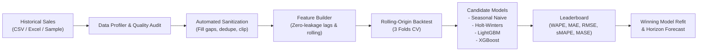

# Forecastly 📈

An automated sales forecasting web application that transforms historical retail data into accurate multi-step forecasts with model leaderboard comparison in 3 clicks.

Designed for non-technical retail analysts and planners with modern SaaS aesthetics (Linear / Vercel style), dark/light mode, and high-performance ML backtesting.

---

## Architecture



---

## Free-Hosting Architecture Constraints

Optimized to run reliably on 1–2 GB RAM, CPU-only ephemeral cloud containers (Render, Railway, Fly.io, Cloud Run):
- **CPU cap**: Thread pools constrained to `n_jobs <= 2`.
- **Upload safety**: Hard ceiling of 10 MB and 200,000 rows.
- **In-process queue**: Uses FastAPI `BackgroundTasks` and SQLite job status polling without Redis or Celery.
- **Ephemeral recovery**: If instances restart and storage is cleared, returns friendly notices prompting re-upload or sample data.
- **Lazy loading**: Heavy forecasting libraries (e.g. Prophet) are lazy-loaded and disabled by default (`ENABLE_PROPHET=false`).

---

## Quick Start

### 1. Local Development (Without Docker)

#### Prerequisites
- Python 3.11+
- Node.js 18+ and npm

#### Backend Setup
```bash
# 1. Create and activate virtual environment
python3 -m venv .venv
source .venv/bin/activate

# 2. Install dependencies
pip install -r backend/requirements.txt

# 3. Run test suite
PYTHONPATH=. pytest backend/tests -v

# 4. Start backend server
python3 -m backend.app.main
# Backend runs on http://localhost:8080 (API docs at http://localhost:8080/docs)
```

#### Frontend Setup (Separate Terminal)
```bash
cd frontend
npm install
npm run dev
# Vite dev server runs on http://localhost:5173 with auto-proxy to 8080
```

---

### 2. Single-Command Production Build

To build the frontend and serve both API and UI from the single FastAPI instance:

```bash
# Build frontend static bundle
npm --prefix frontend run build

# Start FastAPI serving static SPA + API on port 8080
source .venv/bin/activate
uvicorn backend.app.main:app --host 0.0.0.0 --port 8080
```
Open **http://localhost:8080** in your browser.

---

### 3. Docker Deployment

```bash
# Build multi-stage container
docker build -t forecastly:latest .

# Run container on port 8080
docker run -p 8080:8080 forecastly:latest
```

Using Docker Compose:
```bash
docker compose up --build
```

---

## Environment Variables

| Variable | Default | Description |
| :--- | :--- | :--- |
| `PORT` | `8080` | Web server listening port |
| `HOST` | `0.0.0.0` | Binding host address |
| `DEBUG` | `false` | Enable verbose logging |
| `DATABASE_URL` | `sqlite:///storage/forecastly.db` | SQLite connection string |
| `MAX_UPLOAD_SIZE_BYTES` | `10485760` (10 MB) | Maximum upload payload size |
| `MAX_UPLOAD_ROWS` | `200000` | Maximum rows accepted in spreadsheet |
| `N_JOBS` | `2` | Parallel thread limit for tree models |
| `ENABLE_PROPHET` | `false` | Optional Facebook Prophet model integration |
| `DEFAULT_METRIC` | `wape` | Default metric to determine leaderboard winner |

---

## REST API Overview

- `GET /health`: Server health check and feature flags
- `POST /api/datasets/sample`: Generate synthetic retail data (3 stores × 5 products, 3 years daily)
- `POST /api/datasets/upload`: Upload CSV/Excel dataset with automated column inference
- `GET /api/datasets/{id}/preview`: Paginated row inspection and inferred data types
- `GET /api/datasets/{id}/profile`: Comprehensive data quality report
- `POST /api/datasets/{id}/clean`: Execute automated sanitization and audit logging
- `POST /api/datasets/{id}/mapping`: Override detected date/target/group column roles
- `GET /api/datasets/{id}/series`: List available sliceable series
- `POST /api/runs`: Enqueue rolling backtest and forecast job
- `GET /api/runs/{id}`: Poll background training progress (0–100%)
- `GET /api/runs/{id}/result`: Fetch winning model, leaderboard metrics, and forecast series
- `GET /api/runs`: List historical runs
- `GET /api/runs/{id}/download`: Export forecast as CSV

---

## 10-Point Manual Acceptance Checklist

1. **One-Click Sample Data**: Click "Try Sample Data" on the Overview screen. Verify 16,425 rows are loaded across 3 stores and 5 products.
2. **Column Auto-Detection**: Navigate to Data Quality screen; confirm `date` is marked as Date, `sales` as Target, and `store`/`product` as Group columns.
3. **Quality Audit Report**: Check the data health checklist. Confirm missing dates, duplicates, negatives, and outlier checks are displayed with plain-English fixes.
4. **Automated Cleaning Action**: Click "Fix Automatically". Verify audit logs are created showing applied sanitizations and health score updates.
5. **Role Override**: Click "Edit Roles" in the Data screen, reassign columns, and confirm the dataset is re-profiled without error.
6. **Configurable Horizon Presets**: On the Forecast Studio screen, toggle horizon between 7, 14, 30, and 90 days.
7. **Model Multi-Select**: Select candidate models (Seasonal Naive, Holt-Winters, LightGBM, XGBoost) and click "Run Forecast".
8. **Real-time Progress Stepper**: Observe the live progress bar and status steps (Validate → Train Models → Backtest Folds → Forecast Horizon).
9. **Interactive Visualization & Leaderboard**: Review the forecast chart with shaded future horizon, 80% confidence bands, and backtest prediction toggle. Inspect the leaderboard for the winning model badge.
10. **CSV Export & Run Registry**: Click "Download Forecast (CSV)" to verify downloaded predictions. Visit the Model Registry to compare historical runs side-by-side.
