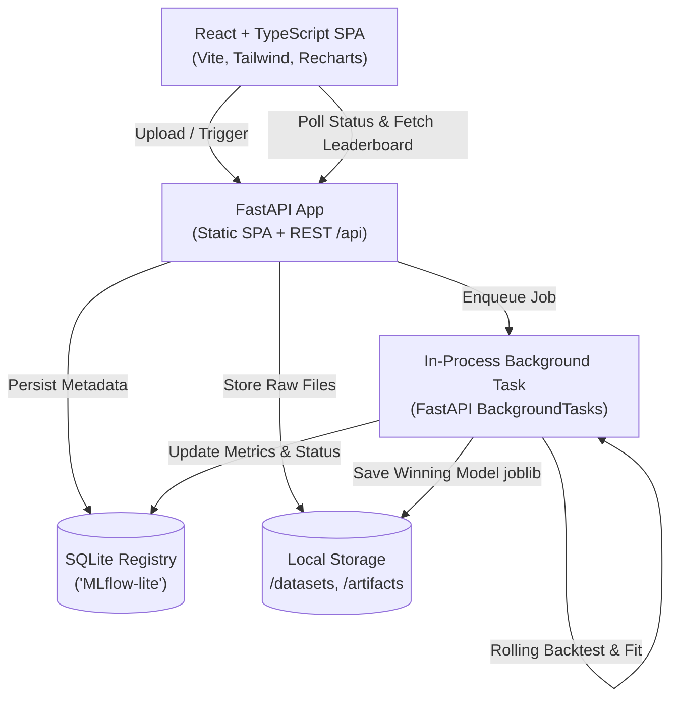

# Forecastly Architecture & Engineering Design

Forecastly is an automated sales forecasting web application designed to run on resource-constrained (1–2 GB RAM, CPU-only) ephemeral hosting platforms.

## Service Layer Decoupling

The codebase strictly decouples API routing from business logic:
- `backend/app/api/`: Typed HTTP route handlers validating inputs and returning Pydantic schemas.
- `backend/app/services/`:
  - `sample_data.py`: Generates realistic retail series (trend, weekly/yearly seasonality, promo multipliers, outages).
  - `data_profiler.py`: Analyzes calendar continuity, duplicates, nulls, outliers, and computes health scores.
  - `data_cleaner.py`: Deduplicates keys, fills timeline gaps, clips negatives and outliers, producing audit logs.
  - `feature_builder.py`: Constructs calendar, cyclical, lag, and rolling statistics with zero future leakage.
  - `metrics.py`: Computes MAE, RMSE, WAPE, sMAPE, and MASE.
  - `forecasters/`: Modular implementations under an abstract base interface (`SeasonalNaive`, `HoltWinters`, `LightGBM`, `XGBoost`, and optional `Prophet`).
  - `backtest.py`: Rolling-origin expanding-window cross-validation and leaderboard ranking.
  - `run_manager.py`: Background job executor managing step progress and joblib model serialization.
