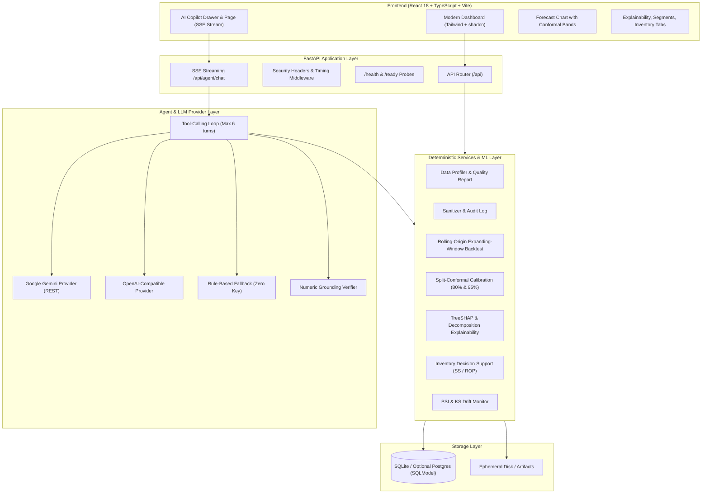
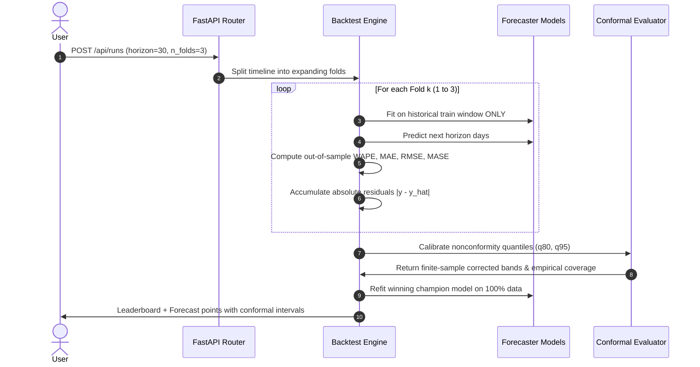
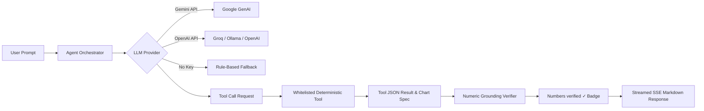

# Forecastly System Architecture

Forecastly is designed as a modular, low-overhead automated sales forecasting platform adhering strictly to free-hosting limits (<= 2 GB RAM, CPU-only).

---

## 1. End-to-End Architecture

---

## 2. Zero-Leakage Rolling-Origin Backtesting

---

## 3. Conversational AI Agent Grounding Architecture

